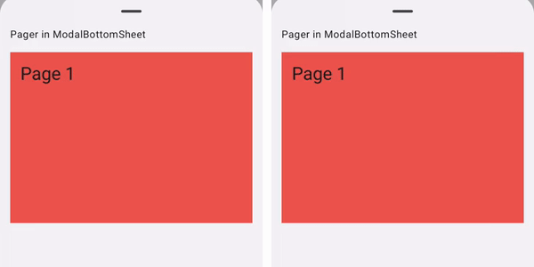
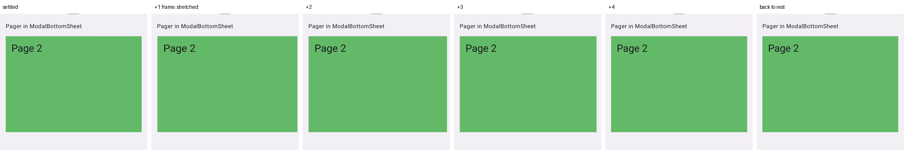

# Material3 `ModalBottomSheet`: a horizontal pager stretches against the swipe after it settles

Minimal Jetpack Compose repro (no other libraries). A `HorizontalPager` inside a Material3 `ModalBottomSheet` settles on its page, then plays the stretch overscroll in the **opposite** direction of the swipe and springs back. The same pager outside the sheet settles cleanly.

- Affected: `androidx.compose.material3` **1.5.0-alpha10 → 1.5.0-beta02** (latest at the time of writing).
- Not affected: **1.5.0-alpha09** and earlier, including **1.4.0** stable.
- Visible on Android 12+, where overscroll is the stretch effect.
- Found through [expo/expo#52068](https://github.com/expo/expo/issues/52068).

## Video

Left: Material3 1.4.0. Right: Material3 1.5.0-beta02. Same swipe, played at half speed.



Frames right after the page settles (1.5.0-beta02). The page is drawn wider for a few frames, then returns to rest:



Raw recordings: [`media/raw-sheet-1.5.0-beta02.mp4`](media/raw-sheet-1.5.0-beta02.mp4), [`media/raw-sheet-1.4.0.mp4`](media/raw-sheet-1.4.0.mp4), [`media/raw-inline-1.5.0-beta02.mp4`](media/raw-inline-1.5.0-beta02.mp4).

## Run it

```sh
./gradlew installDebug                              # Material3 1.5.0-beta02 (default)
./gradlew installDebug -Pmaterial3=1.4.0            # last stable without the bug
```

Only Material3 changes between builds. Foundation is pinned to 1.12.1.

1. Swipe the inline pager. Each page eases into place.
2. Tap **Open pager in ModalBottomSheet** and fling between pages, fast flings show it best. After the page settles, it stretches against the swipe and springs back.

## Measurements

Android 17 emulator (Pixel profile), `adb shell input swipe` flings (50 ms), screen recorded. The value is the largest move of the page's edges after the page first reaches its rest position (0 px = settles cleanly).

| Material3 | Pager in `ModalBottomSheet` | Inline pager |
| --- | --- | --- |
| 1.4.0 | 0 px | 0 px |
| 1.5.0-alpha09 | 0 px | 0 px |
| 1.5.0-alpha10 | 32–33 px | 0 px |
| 1.5.0-beta02 | 32 px | 0 px |

## Root cause

The sheet wraps its content with `ConsumeSwipeWithinBottomSheetBoundsNestedScrollConnection` (`SheetDefaults.kt`). Its `onPostFling` in 1.5.0-beta02:

```kotlin
override suspend fun onPostFling(consumed: Velocity, available: Velocity): Velocity {
    val toFling = available.toFloat()
    val consumedByAnchoredDraggableFling = sheetState.anchoredDrag(flingBehavior, toFling)
    return Velocity(consumed.x, consumedByAnchoredDraggableFling)
}
```

`onPostFling` returns the velocity *this connection* consumed from `available`. For a vertical sheet it returns `consumed.x`, the horizontal velocity the **child already consumed**, as if the sheet had consumed it.

Foundation's `Scrollable` (1.12.1, `Scrollable.kt`) then computes what is left for overscroll:

```kotlin
val velocityLeft = doFlingAnimation(available)
val consumedPost = nestedScrollDispatcher.dispatchPostFling((available - velocityLeft), velocityLeft)
val totalLeft = velocityLeft - consumedPost
velocity - totalLeft
```

On the x axis, `consumedPost.x = available.x - velocityLeft.x`, so `totalLeft.x = 2 * velocityLeft.x - available.x`. The pager consumes nearly all of its fling while snapping (`velocityLeft.x ≈ 0`), so `totalLeft.x ≈ -available.x`. The overscroll effect receives a fling about as fast as the swipe but **in the opposite direction**, and the stretch overscroll plays it.

The inline pager has no sheet connection above it, so `consumedPost` is zero and nothing is left over.

## When it was added

`onPostFling` in each release of `material3-android` (sources jars from Google Maven):

| Version | `onPostFling` returns |
| --- | --- |
| 1.4.0 | `available` |
| 1.5.0-alpha01 … alpha09 | `available` |
| **1.5.0-alpha10** … 1.5.0-beta02 | `Velocity(consumed.x, consumedByAnchoredDraggableFling)` |

1.5.0-alpha10 is where `SheetState` moved from Material3's internal `AnchoredDraggableState` fork to foundation's `androidx.compose.foundation.gestures.AnchoredDraggableState`, and the connection was rewritten around `anchoredDrag(flingBehavior, …)`.

## Possible fix (not tested)

Report only the sheet's own consumption, on the sheet's axis:

```kotlin
return if (orientation == Orientation.Horizontal) {
    Velocity(consumedByAnchoredDraggableFling, 0f)
} else {
    Velocity(0f, consumedByAnchoredDraggableFling)
}
```

## Environment

- Android 17 emulator (API 37), arm64.
- AGP 9.2.1, Kotlin 2.2.10, Gradle 9.4.1, compileSdk 37, foundation 1.12.1.
